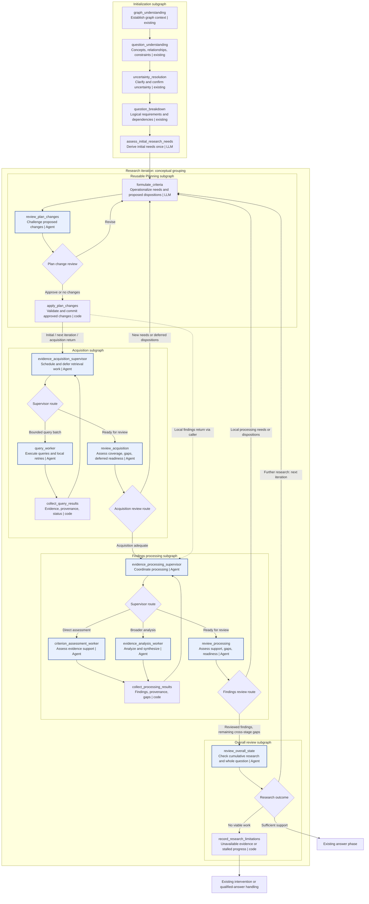

# Adaptive Evidence-Driven Research (AEDR)

AEDR organizes planning and execution around answering the **whole question** using cumulative evidence and findings.
Criteria are actionable requirements serving that shared objective, including relationships across findings.

Initialization preserves the existing graph and question-understanding pipeline and adds a **one-time initial
research-needs assessment**. The three fixed research `PlanStep` instances remain **Acquisition, Findings, Review**;
Planning is a reusable orchestration subgraph, **not** a fourth `PlanStep`. Initialization and subsequent contextual
reviews identify what research is needed. Planning turns identified needs and criterion-disposition recommendations
into actionable criteria or changes to existing criteria; supervisors coordinate execution. Acquisition and Findings
reviews can return through Planning for scoped corrective work within the same iteration. Overall Review determines
whether the cumulative evidence supports the whole question and, when necessary, triggers the next iteration through
Planning. Complexity affects the amount of work, not the required integrity checks.

Rectangles represent executable LangGraph nodes; diamonds represent conditional-edge routing, not additional nodes.
**Agent** denotes a model/tool loop, **LLM** a focused model call, and **code** application logic. These are proposed
roles, not instructions to replace existing implementations. The iteration box is conceptual; parent orchestration
may invoke the Planning subgraph multiple times within an iteration. A review should not mutate criterion status.



The lines leaving Planning indicate **context-dependent continuation**, not simultaneous execution of both subgraphs.
When invoked for acquisition corrections, Planning returns to the acquisition supervisor; for findings corrections,
it returns to findings processing. After Overall Review requests another iteration, Planning starts that next cycle
at Acquisition. Reviewer-produced needs and readiness recommendations do not themselves mutate criteria.

## Initialization subgraph

Preserve graph understanding, question understanding, uncertainty resolution (including user confirmation), and
question breakdown. Then run **`assess_initial_research_needs`** once to derive initial `ResearchNeed` instances from
the confirmed question, intent, decomposition, and known graph capabilities. It does **not** create criteria or the
plan; it produces the same kind of need input subsequently produced by contextual reviews. This assessment belongs
inside Initialization for organizational clarity and is not repeated at the beginning of every iteration.

## Planning subgraph

Planning is a **reusable operationalization mechanism**. It does not independently determine whether research is
sufficient or discover what else is needed. Initial assessment and contextual reviews make those judgments. Planning
accepts their structured needs, references to existing criteria, and recommendations concerning affected or deferred
work. The same Planning subgraph may be invoked before initial acquisition, after a scoped review, or at the start of
a later iteration. See [Illustrative data contracts](#illustrative-data-contracts).

- **`formulate_criteria` — LLM:** Replaces `reconcile_plan`. Converts needs not yet represented by adequate work into
  one or more actionable criteria, or formulates requested changes to existing criteria (including moving deferred
  criteria back to an eligible status). It uses the current plan and existing need/criterion references to avoid
  duplicates, but does **not** redo the originating assessment. The three fixed `PlanStep` instances are Acquisition,
  Findings, and Review. Criteria describe what must be accomplished and accepted, not every query or method.
- **`review_plan_changes` — Agent:** Challenges proposed criterion additions, modifications, and status transitions
  for correctness, necessity, duplication, and consistency with the originating need and research intent. It can
  request revision or reject unjustified changes.
- **`apply_plan_changes` — code:** Validates references and transitions and commits approved changes, preserving
  provenance and revision history. A no-change result is valid, especially when a reported need already has suitable
  actionable work. This is the only planning-stage mutation of criterion status or definition.

A `ResearchNeed` can have one or several associated criteria, and a criterion may address multiple needs. If a review
reports that an existing deferred criterion is ready for reconsideration, Planning **does not create another need or
criterion**. It proposes the appropriate status/eligibility change, subject to review and application. Making a
criterion eligible means the supervisor **may consider** it; eligibility does not require immediate execution.

### Deferred criteria and progressive work

A criterion can be **deferred** when prerequisites or inputs are unavailable. Deferral is not equivalent to an
unsupported conclusion. Record the blocking condition and what would permit resumption, referencing the original
research need. Supervisors can defer work when execution reveals unmet dependencies and can sequence work that is
already eligible. An acquisition or findings review may later determine that a deferred criterion is now eligible,
or that another prerequisite must be addressed first. It reports that determination as a structured disposition
proposal or an additional `ResearchNeed`; it **does not change the criterion itself**.

When a deferred criterion already represents the relevant need, do not create a duplicate need. Planning uses the
review's explicit criterion reference to propose restoring eligibility, retaining deferral, or changing the existing
criterion if required. An unresolved, material deferral prevents full answer readiness while a viable path remains;
when no viable path exists, record a limitation or use intervention handling instead of looping indefinitely.

Known dependencies should inform the supervisor's sequencing and batching, but the design does not prescribe a new
criterion-level `depends_on` field. Defer requirements that cannot yet be meaningfully specified; later contextual
reviews can identify them once evidence makes them apparent.

## 1. Acquisition subgraph

Acquisition retrieves evidence for available acquisition criteria in the context of the whole question. Acceptance
means that the current acquisition requirements were adequately addressed, **not** that the whole question is
answered.

- **`evidence_acquisition_supervisor` — Agent:** Coordinates retrieval, bounded parallel query batches, and
  prerequisite-sensitive sequencing. It considers eligible criteria, may defer blocked work with a reason and
  resumption condition, and retries operational failures locally. It does **not** independently invent new criteria.
- **`query_worker` — Agent:** Executes assigned graph queries and local repairs/retries without repeating successful
  work.
- **`collect_query_results` — code:** Collects evidence, provenance, execution status, and errors; retains successes.
- **`review_acquisition` — Agent:** Assesses actual results against acquisition criteria and intent, including
  incomplete coverage, missing projected properties, truncation, irrelevance, unsupported acceptance, and deferred
  work whose prerequisites may now be met. It emits structured new needs and/or **dispositions referencing existing
  criteria**, never direct mutations. It can report that a deferred criterion remains blocked or that a different
  prerequisite is needed before it can resume.

If acquisition review identifies missing substantive work or an eligibility change, route through the **same Planning
subgraph** (`formulate_criteria → review_plan_changes → apply_plan_changes`) and return to the acquisition supervisor
**within the current iteration**. A deferred criterion that can now run is made eligible through Planning; the
supervisor then determines whether and when to execute it. If acquisition is sufficient, proceed to Findings. Query
timeouts and routine retries can be handled by the worker or supervisor without inventing needs or invoking Planning.

If required work cannot proceed within acquisition, preserve the unresolved dependency or limitation for Overall
Review rather than running an unproductive local loop. The acquisition reviewer assesses, Planning operationalizes,
and the supervisor executes; each retains its own responsibility.

## 2. Findings processing subgraph

Determines what the cumulative evidence establishes about the whole question, including relationships,
contradictions, and gaps across criteria. Reuse unaffected accepted work and process new or changed evidence.

- **`evidence_processing_supervisor` — Agent:** Coordinates direct assessment, comparison, synthesis, screening,
  aggregation, and other needed operations. Sequences dependent work and handles operational retries or deferral.
  It does not create new criteria independently.
- **`criterion_assessment_worker` — Agent:** Assesses direct evidentiary support against the applicable criterion,
  distinguishing observation, inference, contradiction, and uncertainty.
- **`evidence_analysis_worker` — Agent:** Analyzes and synthesizes evidence, recording methods, assumptions, findings,
  limitations, and provenance.
- **`collect_processing_results` — code:** Collects findings, validation outcomes, methods, provenance, gaps, and
  contradictions without manufacturing consensus.
- **`review_processing` — Agent:** Evaluates support, logical validity, contradictions, provenance, and faithfulness,
  reusing existing Ragas checks where appropriate. Identifies local processing needs and deferred-readiness
  dispositions as structured outputs, rather than inventing or mutating criteria itself.

Local findings needs and criterion dispositions may route through **Planning** and back to processing within the same
iteration. Missing acquisition evidence that requires another acquisition phase is reported as a cross-stage need for
Overall Review rather than jumping directly into acquisition. Keep routine corrective processing local when no
criterion change is needed.

## 3. Overall review subgraph

Reviews the **Review** plan step's criteria and determines whether the cumulative research adequately answers the
original whole question. Individual accepted criteria inform but do not replace this judgment.

- **`review_overall_state` — Agent:** Assesses cumulative evidence, findings, unresolved or deferred criteria,
  contradictions, and the original question. Identifies remaining research needs, affected existing work, and
  limitations with supporting references. It does **not** create criteria, change statuses, or invoke another
  general-purpose research-needs assessment.
- **Research-outcome routing — conditional edge:** If support is sufficient, continue to the existing answer phase.
  If more research is viable, invoke **Planning** with the review's structured needs/dispositions to begin the **next
  iteration** at Acquisition. If required information is unavailable or progress is stalled, use existing
  limitation/intervention handling.
- **`record_research_limitations` — code:** Retains unresolved requirements, failed approaches, unavailable evidence,
  and reasons for stopping, so a qualified answer does not imply unsupported completeness.

The overall review assesses the whole research state, including interactions across findings that focused reviews
cannot necessarily recognize. It emits the same kinds of structured needs or affected-criterion recommendations as
other reviews, but at global scope. Planning acts on these directly, without a redundant second assessment.

## Shared state and review scope

`GraphRAGState` retains the cumulative question, decomposition, intent, fixed plan steps, criteria, evidence, findings,
provenance, review results, and outstanding needs. `IterationRecord` records **new activity and changes from one
iteration** (including plan invocations, criterion changes, acquisition and findings outcomes, and reviews). The new
iteration scope covers Planning, Acquisition, Findings, and Overall Review, though Planning may also be invoked again
locally within a stage. Adapt the existing records instead of introducing a redundant state store. New evidence may
invalidate or reopen a finding; retain the original history while excluding invalidated findings from accepted
support. See [Illustrative data contracts](#illustrative-data-contracts).

There is **one initial needs assessment** during Initialization. Each of the three contextual reviews subsequently
assesses adequacy within its own responsibility and can emit needs, identified deficiencies, or proposed dispositions
for existing criteria. Planning **formulates and applies actionable criterion changes**, not research judgments.
Acquisition/Findings reviews can loop through Planning locally; Overall Review routes additional research through
Planning to the next full iteration. Review never directly modifies criterion status, and the supervisor chooses
execution of criteria that become eligible.

Preserve validated structured routing and affected identifiers rather than interpreting free-form reviewer prose.
Review may judge that a blocked criterion is ready, remains blocked, or needs another prerequisite satisfied first.
If a need already has an adequate existing criterion, reference it rather than minting a second need or criterion.
Retain evidence, plan changes, rejected proposals, and rationale for traceability. Avoid infinite local or outer
loops when meaningful progress is no longer possible.

## Illustrative data contracts

The following Pydantic examples illustrate **handoff semantics**, not mandatory replacements for existing application
models. Integrate with the real `Criterion`, `IterationRecord`, `GraphRAGState`, provenance, review, and status types.
They show how one need can be operationalized and later reconsidered without a new needs assessment. Initial needs
and contextual-review needs use the same `ResearchNeed` representation.

### Needs and contextual review output

The initial assessor emits needs. Reviews inspect their own scope and can emit additional needs or recommendations
about existing criteria (including deferred-readiness). Neither a review nor the initial assessment mutates criteria.

```python
from enum import StrEnum
from typing import Literal
from pydantic import BaseModel, Field

ResearchStep = Literal["acquisition", "findings", "review"]

class ResearchNeed(BaseModel):
    id: str
    description: str
    intent: str
    target_step: ResearchStep
    question_requirement_ids: list[str] = Field(default_factory=list)
    rationale: str
    satisfaction_conditions: list[str] = Field(default_factory=list)
    related_criterion_ids: list[str] = Field(default_factory=list)

class ResearchLimitation(BaseModel):
    description: str
    rationale: str
    affected_need_ids: list[str] = Field(default_factory=list)
    evidence_refs: list[str] = Field(default_factory=list)

class CriterionDisposition(StrEnum):
    RECONSIDER_DEFERRED = "reconsider_deferred"
    KEEP_DEFERRED = "keep_deferred"
    REVISE = "revise"
    REOPEN = "reopen"

class CriterionDispositionRecommendation(BaseModel):
    criterion_id: str
    need_ids: list[str] = Field(default_factory=list)
    disposition: CriterionDisposition
    rationale: str
    supporting_refs: list[str] = Field(default_factory=list)
    prerequisite_notes: str | None = None

class ContextualReviewOutput(BaseModel):
    scope: ResearchStep
    new_needs: list[ResearchNeed] = Field(default_factory=list)
    criterion_recommendations: list[CriterionDispositionRecommendation] = Field(default_factory=list)
    affected_finding_ids: list[str] = Field(default_factory=list)
    limitations: list[ResearchLimitation] = Field(default_factory=list)
    adequate_within_scope: bool
    rationale: str
```

For a deferred criterion whose prerequisite has become available, the reviewer references its **existing**
`criterion_id`
and `need_ids`, recommending reconsideration. It does **not** create a duplicate `ResearchNeed`, change status, or
schedule execution. `adequate_within_scope` describes adequacy for the review's responsibility; the overall reviewer
also determines whole-question readiness and routing.

### Criterion formulation and reviewed changes

The reusable Planning subgraph receives needs and existing-criterion recommendations. `formulate_criteria` produces
proposed changes; `review_plan_changes` checks them, and `apply_plan_changes` validates and commits them. Criteria
made eligible may be considered by a supervisor but are not forced into immediate execution.

```python
class CriterionStatus(StrEnum):
    PENDING = "pending"
    ACTIVE = "active"
    COMPLETE = "complete"
    DEFERRED = "deferred"
    UNSUPPORTED = "unsupported"

class DeferredWork(BaseModel):
    criterion_id: str
    need_ids: list[str] = Field(default_factory=list)
    reason: str
    resume_when: str
    required_for_answer: bool = True

class CriterionProposal(BaseModel):
    target_step: ResearchStep
    need_ids: list[str]
    description: str
    intent: str
    acceptance_conditions: list[str]
    rationale: str

class CriterionChangeAction(StrEnum):
    ADD = "add"
    REVISE = "revise"
    REOPEN = "reopen"
    MAKE_ELIGIBLE = "make_eligible"
    NO_CHANGE = "no_change"

class CriterionChange(BaseModel):
    action: CriterionChangeAction
    criterion_id: str | None = None
    need_ids: list[str] = Field(default_factory=list)
    proposed_status: CriterionStatus | None = None
    rationale: str

class PlanChangeSet(BaseModel):
    changes: list[CriterionChange] = Field(default_factory=list)
    proposed_criteria: list[CriterionProposal] = Field(default_factory=list)
    rationale: str
```

A `MAKE_ELIGIBLE` change would normally propose a transition from `DEFERRED` to `PENDING`, subject to the application's
actual status model and transition validation. That transition is enacted by application code after plan-change review,
not by the contextual reviewer. Supervisors still determine scheduling and may defer a criterion again if its
prerequisites are not actually satisfied. The review can alternatively recommend retaining the deferral and identify
another need that must be satisfied first.

### Integration with cumulative state and iteration history

Use existing `GraphRAGState` as authoritative cumulative in-memory state and existing `IterationRecord` as the record
of changes made during a particular research iteration. The examples below show the **kinds** of additional references
AEDR may require, not complete replacements for either class.

```python
class IterationPlanningActivity(BaseModel):
    originating_review_id: str | None = None  # None for the initial assessment
    need_ids: list[str] = Field(default_factory=list)
    proposed_change_ids: list[str] = Field(default_factory=list)
    applied_change_ids: list[str] = Field(default_factory=list)

class IterationReviewActivity(BaseModel):
    review_id: str
    scope: ResearchStep
    new_need_ids: list[str] = Field(default_factory=list)
    affected_criterion_ids: list[str] = Field(default_factory=list)
    disposition_recommendation_ids: list[str] = Field(default_factory=list)
```

One `IterationRecord` may contain more than one Planning invocation when a local review identifies additional work.
The record captures what was proposed, accepted, executed, deferred, or corrected in that iteration. `GraphRAGState`
reflects the currently accepted cumulative state while historical records preserve prior results and decisions.

## Implementation Notes

Preserve existing research-integrity mechanisms and optimizations. Before replacing the current orchestration, identify
the techniques already implemented for evidence provenance, bulk data retrieval, indexed lookups, Ragas-based
faithfulness evaluation, relevance assessment, validation, and traceability. Reuse these mechanisms in AEDR wherever
appropriate, adapting their integration points to the new subgraphs. Do not replace proven integrity mechanisms with
simpler but weaker alternatives merely to accommodate the new workflow. The objective is to redesign planning and
orchestration while retaining the accuracy, verifiability, and efficiency improvements already developed.
