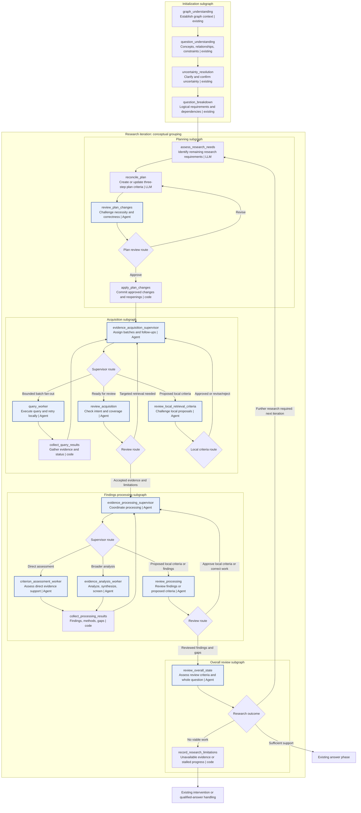

# Adaptive Evidence-Driven Research (AEDR)

AEDR organizes planning and execution around answering the **whole question** using cumulative evidence and findings.
Criteria are actionable requirements serving that shared objective, including relationships across findings.

Initialization preserves the existing graph and question-understanding pipeline. Every research iteration performs
**research-needs assessment → planning → acquisition → findings → overall review**. The needs assessor examines the
current research state and identifies what remains necessary; planning translates those needs into actionable criteria.
Overall review checks whether the question is adequately supported. If not, the next iteration begins with the same
needs assessor, now informed by the accumulated evidence, findings, and review challenges. The research **plan** retains
three predefined `PlanStep` instances: **Acquisition, Findings, Review**. Planning is an orchestration stage that
creates or updates their criteria; it is **not** a fourth `PlanStep`. Question complexity changes the amount of work,
query batches, processing, and number of iterations, not the iteration stages or integrity checks. A stage with no new
work reuses accepted results while still performing its required assessment.

Rectangles represent executable LangGraph nodes; diamonds represent conditional-edge routing, not additional nodes.
**Agent** denotes a model/tool loop, **LLM** a focused model call, and **code** application logic. These are proposed
roles, not a requirement to replace existing implementations. Supervisors and scoped reviewers may use agents where
autonomous inspection helps; focused structured calls and deterministic checks may suffice in some cases. Worker nodes
can fan out concurrently. The iteration box is conceptual; the parent LangGraph orchestrates successive subgraph
invocations.



Initialization node names identify existing responsibilities conceptually: retain the project's existing understanding
pipeline and ordering. AEDR changes planning and research execution. The research-needs assessor is invoked at the
beginning of each iteration, not during initialization or by the overall-review subgraph.

## Initialization subgraph

Initialization performs the existing graph understanding, question understanding, semantic/conceptual uncertainty
resolution (including user confirmation), and question breakdown. It **does not construct the plan or assess research
needs**. Its outputs provide the initial context for the first research iteration.

## Research-needs assessment

**`assess_research_needs` — LLM:** The first node in every iteration. Examines the confirmed question, breakdown,
intent, graph capabilities, cumulative evidence and findings (when available), and prior review challenges. Determines
what is still necessary to answer the question, including unresolved requirements, dependencies, affected work, and
limitations. Produces a structured set of research needs for Planning without drafting or applying plan criteria. A need
describes what remains necessary, not how it must be executed; see [Illustrative data
contracts](#illustrative-data-contracts).

The same node and contract serve the first and every subsequent iteration. The initial assessment starts with no
research evidence; later assessments incorporate the accumulated research state. No first-iteration mode is required.

## Planning subgraph

Planning no longer turns question-breakdown elements into top-level research steps or attempts to predict the entire
research sequence. It reconciles the current iteration's research-needs assessment with cumulative state and the
existing plan.

- **`reconcile_plan` — LLM:** Creates the three predefined `PlanStep` instances when absent, or updates their criteria
when present. The plan steps are **Acquisition** (what graph evidence is needed), **Findings** (what must be established
from it), and **Review** (what must be checked to judge whole-question adequacy). Criteria carry intent, acceptance
conditions, and dependencies. The planner can propose new/revised criteria and reopening of existing work; it preserves
accepted work and does not prescribe every query or analytical technique.
- **`review_plan_changes` — Agent:** Challenges proposed changes for necessity, correctness, consistency with the
original question and intent, duplication, and fit to the responsible step. It may request revision or reject
unjustified expansion.
- **`apply_plan_changes` — code:** Applies approved criterion additions/revisions and reopenings together, retaining
reasons and provenance links. Unaffected prior work remains reusable.

**Planning is iteration-independent.** Every pass receives the same assessment contract from `assess_research_needs`.
The plan may be absent/empty or already populated, but Planning need not branch on iteration number. Its input includes
outstanding needs, implicated criteria/findings, limitations, and supporting rationale. It reconciles each need against
existing criteria and deferred work before proposing a change: reuse an already sufficient criterion, resume deferred
work, reopen or revise affected work, add a missing criterion, or make no change when the need is already addressed. One
need may require several criteria, while one criterion may address several needs. Plan reconciliation may produce no
changes when current criteria already cover the work. See [Illustrative data contracts](#illustrative-data-contracts).
If no viable work remains, the workflow uses existing limitation/intervention handling instead of repeatedly creating
equivalent requirements.

### Deferred criteria and progressive planning

A criterion may be **deferred** when required inputs or earlier work are not yet available. Deferred is distinct from
unsupported: the criterion has not yet received a conclusive evaluation. Record why it is deferred and what would make
it actionable. Material, unresolved deferred work prevents declaring the research fully supported and requires another
iteration when a viable path remains; impossible or exhausted work moves to limitation/intervention handling instead of
looping indefinitely. Needs assessment and plan reconciliation reconsider deferred criteria each iteration.

The planner captures requirements and dependencies that are already understood, even when their inputs will be available
only after other work. Supervisors sequence dependent operations and batch independent operations as inputs become
available. Requirements that cannot yet be meaningfully specified may be introduced by later assessments. This does not
require a particular criterion-level `depends_on` field; that representation is an implementation choice. For
illustrative status and reconciliation models, see [Illustrative data contracts](#illustrative-data-contracts).

## 1. Acquisition subgraph

Acquires evidence for outstanding or affected acquisition criteria in the context of the whole question. Acceptance
means the current retrieval requirements were adequately addressed, **not** that the whole question is answered.

- **`evidence_acquisition_supervisor` — Agent:** Coordinates retrieval across criteria using the question, intent,
breakdown, and cumulative state. Fans out independent queries in bounded batches, sequences dependent queries, and
proposes local retrieval criteria when acquired data reveals missing information necessary to fulfill the current
acquisition intent.
- **`review_local_retrieval_criteria` — Agent:** Checks local proposals for necessity, correctness, and fit before they
are added and executed within the current acquisition invocation.
- **`query_worker` — Agent:** Executes assigned graph queries, checks success, and handles local query retries without
repeating successful work.
- **`collect_query_results` — code:** Collects evidence, provenance, and execution status; retains successes and makes
failures explicit.
- **`review_acquisition` — Agent:** Challenges missing properties, poor projections, irrelevant data, incomplete
coverage, truncation, and unsupported acceptance claims against retrieval criteria and intent. Directs targeted
correction through the supervisor. Passes accepted evidence and explicit unresolved limitations to Findings.

Additional batches, local criterion additions, and corrective retrieval stay within acquisition rather than starting
another research iteration.

## 2. Findings processing subgraph

Determines what the accumulated evidence establishes about the whole question, including relationships, contradictions,
and gaps across criteria. Processes new or affected work and reuses unaffected accepted results.

- **`evidence_processing_supervisor` — Agent:** Determines which evidence must be examined together and selects direct
assessment, comparison, aggregation, synthesis, screening, or other processing as appropriate. Tasks need not map
one-to-one to criteria. It may assign additional tasks under existing findings criteria or propose new local processing
criteria for review. Coordinates independent batches and dependent processing, keeping the whole question and intent in
view.
- **`criterion_assessment_worker` — Agent:** Evaluates evidence against criterion intent and acceptance conditions;
distinguishes direct observations, inference, contradiction, and uncertainty. Produces evidence-linked findings.
- **`evidence_analysis_worker` — Agent:** Performs processing within or across evidence sets and records findings,
methods, assumptions, limitations, and provenance.
- **`collect_processing_results` — code:** Collects processing results, findings, provenance, methods, gaps,
contradictions, and status; preserves disagreements rather than inventing agreement.
- **`review_processing` — Agent:** In proposal-review mode, checks local processing criteria before addition. In
findings-review mode, challenges factual support, reasoning, methods, contradictions, and missing provenance. Existing
provenance techniques and Ragas-based checks may assist but do not replace scoped review. Sends defects for local
correction and unresolved cross-stage needs to overall review.

Local tasks, approved processing criteria, and corrections remain in this subgraph. Missing graph evidence requiring
another acquisition pass is reported to overall review rather than directly re-entering acquisition.

## 3. Overall review subgraph

Evaluates the **Review** plan step's criteria and determines whether the cumulative research adequately answers the
whole question. Review criteria may cover question coverage, cross-finding relationships, consequential contradictions,
and evidentiary support. Satisfying individual criteria informs but does not replace whole-question judgment.

- **`review_overall_state` — Agent:** Examines accumulated evidence, findings, review decisions, unresolved items, and
original question requirements. Records review-criterion outcomes with rationale and evidence/finding references.
Identifies deficiencies, contradictions, and limitations relevant to answer readiness. It **does not draft or apply new
criteria or perform research-needs assessment**. Its recorded challenges inform the next iteration's assessor through
structured review findings (see [Illustrative data contracts](#illustrative-data-contracts)).
- **Research-outcome routing — conditional edge:** Sends adequate research to the existing answer phase; research
requiring further work to the **next iteration's research-needs assessment**; and unavailable evidence or stalled
research to existing limitation/intervention handling.
- **`record_research_limitations` — code:** Records unresolved requirements, attempted work, unavailable evidence, and
reasons for stopping. Qualified or insufficient-data answers must retain those limitations rather than implying adequate
support.

Overall review can identify both missing support and defects in existing work. Its challenges and findings remain in
shared state for the next needs assessment, which determines the outstanding work. Planning translates that assessment
into reviewed, actionable changes. Unresolved review criteria persist for reevaluation against updated cumulative state.

## Shared state and review scope

The original question, breakdown, intent, plan steps, criteria, evidence, findings, provenance, review outcomes, and
latest research-needs assessment form cumulative state. Deferred criteria and their resumption conditions remain visible
to needs assessment and planning. Preserve historical records of corrections, invalidation, and supersession, but
exclude invalidated evidence/findings from accepted support. New evidence may reopen earlier findings, including those
dependent on a changed retrieval scope or population. Reuse unaffected results.

Every research iteration executes **Research-Needs Assessment → Planning → Acquisition → Findings → Overall Review**,
while the **plan** always contains three research steps: **Acquisition → Findings → Review**. The planner updates
criteria from the current assessment without distinguishing the first pass from later passes. Criteria are actionable
requirements, not isolated question silos; the shared research objective governs their creation and evaluation.

Each scoped adversarial review produces concrete challenges with rationale and references. Acquisition and Findings
reviews concentrate on changed or affected work; Overall Review considers the complete cumulative state. Local retries,
corrective work, and locally reviewed criterion additions stay within their responsible subgraph. Overall Review records
cross-stage gaps and challenges; the next iteration's needs assessor determines the outstanding work, and Planning
converts it into plan changes.

Use validated structured decisions and affected IDs rather than parsing review prose to route work. Local subgraphs may
have distinct decision types; the research-needs assessment is the reusable interface between the first node of each
iteration and Planning, not a universal outcome enum. Record unavailable evidence and inconclusive outcomes explicitly;
route stalled progress through existing intervention and limitation handling rather than repeating equivalent work
indefinitely.

### Iteration records and cumulative state

AEDR preserves the distinction between `IterationRecord` and `GraphRagState`. Each `IterationRecord` captures the
new work, results, decisions, and changes produced during one complete `Planning` → `Acquisition` → `Findings` → 
`Overall Review` cycle. This includes research-needs assessments, plan changes, acquired evidence, findings, validation 
outcomes, and review decisions.

`GraphRagState` maintains the cumulative research state across iterations, including the current plan, accumulated
evidence and findings, criterion statuses, provenance, and unresolved requirements. Iteration results contribute to
this state without replacing previously acquired work. Subsequent corrections, invalidations, and supersessions update
the cumulative state while remaining traceable to the iterations in which they occurred.

The existing models should be adapted to AEDR's revised iteration scope rather than replaced unnecessarily.

## Illustrative data contracts

These Pydantic examples illustrate the handoffs that distinguish AEDR from upfront, breakdown-driven planning. They are
**not** prescriptions to replace existing domain models, status types, provenance structures, or review outputs. Names
and fields can be adapted to the application's actual models.

### Research need and review finding

A `ResearchNeed` describes work still required to answer the original question. It is not an executable `Criterion`:
planning may satisfy several needs with one criterion, or split one need into several criteria. An overall-review
finding identifies a diagnosed deficiency and links it to affected work; needs assessment decides what work the
deficiency implies.

```python
from enum import StrEnum
from typing import Literal
from pydantic import BaseModel, Field


ResearchStep = Literal["acquisition", "findings", "review"]


class ResearchNeed(BaseModel):
    id: str
    description: str
    intent: str
    target_step: ResearchStep
    question_requirement_ids: list[str] = Field(default_factory=list)
    rationale: str
    satisfaction_conditions: list[str] = Field(default_factory=list)
    related_criterion_ids: list[str] = Field(default_factory=list)


class ReviewFinding(BaseModel):
    id: str
    deficiency: str
    rationale: str
    question_requirement_ids: list[str] = Field(default_factory=list)
    affected_criterion_ids: list[str] = Field(default_factory=list)
    affected_finding_ids: list[str] = Field(default_factory=list)
    evidence_refs: list[str] = Field(default_factory=list)
```

### Research-needs assessment

The same `ResearchNeedsAssessment` contract applies to every iteration. On the first pass, the assessor uses the
question and breakdown; later it also uses accepted evidence, findings, deferred criteria, and structured review
challenges. A limitation is distinct from a need: it records a constraint on what can be established rather than
prescribing work.

```python
from enum import StrEnum
from typing import Literal
from pydantic import BaseModel, Field

import ResearchNeed, ReviewFinding


class ResearchLimitation(BaseModel):
    description: str
    rationale: str
    affected_need_ids: list[str] = Field(default_factory=list)
    evidence_refs: list[str] = Field(default_factory=list)


class ResearchNeedsAssessment(BaseModel):
    outstanding_needs: list[ResearchNeed] = Field(default_factory=list)
    review_findings: list[ReviewFinding] = Field(default_factory=list)
    affected_criterion_ids: list[str] = Field(default_factory=list)
    affected_finding_ids: list[str] = Field(default_factory=list)
    limitations: list[ResearchLimitation] = Field(default_factory=list)
    rationale: str
```

`review_findings` represents relevant recorded challenges; it does not require the needs assessor to repeat the overall
integrity review or produce new review findings itself. The assessment can instead reference separately stored findings.

### Deferred work and plan reconciliation

A `deferred` criterion is necessary but cannot currently proceed. Its prerequisites and resumption condition remain
explicit; it is not equivalent to a completed but unsupported finding. A material unresolved deferral prevents full
answer readiness while viable work remains. Planning examines deferred and existing criteria before proposing changes.

```python
from enum import StrEnum
from typing import Literal
from pydantic import BaseModel, Field


class CriterionStatus(StrEnum):
    PENDING = "pending"
    ACTIVE = "active"
    COMPLETE = "complete"
    DEFERRED = "deferred"
    UNSUPPORTED = "unsupported"


class DeferredWork(BaseModel):
    criterion_id: str
    reason: str
    resume_when: str
    required_for_answer: bool = True


class ReconciliationAction(StrEnum):
    REUSE = "reuse"
    RESUME = "resume"
    REOPEN = "reopen"
    REVISE = "revise"
    ADD = "add"
    NO_CHANGE = "no_change"


class PlanReconciliationDecision(BaseModel):
    need_ids: list[str] = Field(default_factory=list)
    action: ReconciliationAction
    criterion_ids: list[str] = Field(default_factory=list)
    rationale: str
```

The status enum and `DeferredWork` are illustrative views of information the existing criterion model may already hold.
Neither implies a new criterion-level `depends_on` field; supervisors may sequence operations using available inputs.

### Reviewed plan changes

`reconcile_plan` compares assessed needs with the current plan and proposes a **change set**, rather than reconstructing
the plan. `review_plan_changes` challenges that set; `apply_plan_changes` commits only approved actions. A no-change set
is valid. New criteria belong to one of the three existing plan steps; their full model remains the application's
existing `Criterion` type.

```python
from enum import StrEnum
from typing import Literal
from pydantic import BaseModel, Field

import PlanReconciliationDecision, ResearchStep


class CriterionProposal(BaseModel):
    target_step: ResearchStep
    need_ids: list[str]
    description: str
    intent: str
    acceptance_conditions: list[str]
    rationale: str


class PlanChangeSet(BaseModel):
    decisions: list[PlanReconciliationDecision] = Field(default_factory=list)
    proposed_criteria: list[CriterionProposal] = Field(default_factory=list)
    reopen_criterion_ids: list[str] = Field(default_factory=list)
    rationale: str
```

`PlanChangeSet` is a proposed mutation, not an applied result. Its criteria and reopenings must be validated against
actual plan identifiers, reviewed for necessity and correctness, and applied while preserving existing history.

## Implementation Notes

Preserve existing research-integrity mechanisms and optimizations. Before replacing the current orchestration, identify
the techniques already implemented for evidence provenance, bulk data retrieval, indexed lookups, Ragas-based
faithfulness evaluation, relevance assessment, validation, and traceability. Reuse these mechanisms in AEDR wherever
appropriate, adapting their integration points to the new subgraphs. Do not replace proven integrity mechanisms with
simpler but weaker alternatives merely to accommodate the new workflow. The objective is to redesign planning and
orchestration while retaining the accuracy, verifiability, and efficiency improvements already developed.
